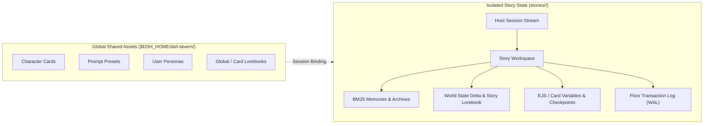

<div align="center">

# dsh-liketavern

**SillyTavern roleplay on the native DeepSeek Harness Agent runtime**

[](https://github.com/Amakurai/dsh-liketavern/releases/tag/v0.5.9)
[](https://deepseek-harness.github.io/deepseek-harness/)
[](https://nodejs.org/)
[](./LICENSE)

[中文](./README.md) · English · [Changelog](./CHANGELOG.md)

</div>

`dsh-liketavern` brings the SillyTavern (ST) ecosystem—character cards, prompt presets, lorebooks, regex scripts, EJS prompt templates, and interactive HTML cards—into [DeepSeek Harness](https://github.com/deepseek-ai/deepseek-harness) (`dsh`). Rather than bolting on a separate request pipeline, it runs directly inside `dsh`'s native session and Agent loop: the host manages model connectivity, long-context history, and tool execution, while the plugin handles prompt orchestration, sandboxed rendering, and transactional story state.

## Why dsh-liketavern

### 1. True Branch Isolation & Transactional State Rollback
In many roleplay frontends, regenerating or rewinding chat history leaves long-term memories, world state, and card variables stuck in the future—contaminating earlier branches.

`dsh-liketavern` strictly separates **shared static assets** (Character Cards, Presets, Personas) from **branch-isolated story state** (`Story`). Every floor write is guarded by a Write-Ahead Log (WAL) before touching state files. Whether you regenerate a turn, edit an AI reply, or fork a conversation from the host message bar, the plugin snapshots the parent story, rolls back uninherited memories, world-state deltas, and variables inside a draft workspace, and atomically binds the new child session—leaving the original timeline untouched.

### 2. Unobtrusive Agent Memory & Dynamic World State
Long-running stories are backed by a three-tier context architecture:
- **Three-Level Lorebooks**: Global, Character-specific, and Story-private lorebooks supporting constant entries, recursive scanning, secondary keys, exclusions, and boolean AND/OR activation.
- **World State Delta Layer**: Tracks newly introduced, modified, and invalidated world facts as the plot unfolds, allowing static lore to evolve naturally.
- **BM25 Long-Term Memory**: Combines lexical relevance with time-decay weighting. During ordinary roleplay, the model streams replies directly; **only when lore is missing or newly established facts need to be persisted** does it invoke `tavern_*` tools via native Programmatic Tool Calling (PTC). When memory capacity is exceeded, background idle maintenance compresses older entries into verifiable source-linked summaries.

### 3. Out-of-the-Box ST Ecosystem: EJS, Tavern Helper & Native MVU
- **Cards & Presets**: Import and export V1 / V2 / V3 PNG and JSON character cards with multiple greetings, embedded lorebooks, and ST prompt presets. The official DeepSeek API-key route projects frozen preset layouts directly onto model messages.
- **EJS Templates & VM Checkpoints**: Built-in ST-compatible EJS engine supporting conditionals, loops, async macros, worldbook decorators, and bundled utilities (`lodash`, `zod`, `faker`, `jsonrepair`), backed by persistent QuickJS VM checkpoints across turns.
- **Tavern Helper Subset & Native MVU**: Supports Global / Preset / Character script libraries, story variable persistence, in-page event buses, and partial message refreshes, plus a built-in native MVU (Model-View-Update) runner for complex status-bar cards.

### 4. Zero-Trust Sandboxing for Third-Party Code
Regex rules, prompt templates, and HTML card scripts bundled inside third-party cards are treated as untrusted input:
- Prompt assembly, lorebook evaluation, regex replacement, Markdown rendering, and EJS execution run inside terminable Worker threads and QuickJS/WASM sandboxes with no access to Node APIs, the DOM, network sockets, or module loaders.
- Interactive HTML cards render inside opaque-origin `sandbox="allow-scripts"` iframes and communicate solely through an enumerated postMessage bridge, preventing privilege escalation into the host window.

---

## Installation & Upgrade

> **Prerequisites**: Node.js `>= 24.0.0`, DeepSeek Harness `>=0.2.0-rc.1 <0.4.0-0`, `pnpm`, and at least one configured model in `dsh`. The development baseline is `0.2.1-rc.3`; the host loader includes prereleases in this range. Back up and verify newer, untested host versions before relying on them. If you are new to `dsh`, see the [DeepSeek Harness Documentation](https://deepseek-harness.github.io/deepseek-harness/) first. Precompiled `lib/` bundles are committed to the repository, so no local build is required during installation.

### Desktop Installation

Open **Plugins → Add plugin** in the `dsh` desktop app, enter the following repository tag URL, and restart the app once installed:

```text
https://github.com/Amakurai/dsh-liketavern.git#v0.5.9
```

### Web / CLI Online Installation

```bash
# Install the plugin into the web profile
dsh plugin --profile web add github:Amakurai/dsh-liketavern#v0.5.9

# Verify installation
dsh plugin --profile web list --depth 0

# Start (or restart) dsh web
dsh web
```

On the tested `0.2.0-rc.1` and `0.2.2-alpha.2` hosts, pnpm may warn that the isolated profile lacks host peer dependencies. The running dsh host supplies those packages, so this warning alone does not mean installation failed. Check that the host version is in range and that the plugin loads after startup; do not assume other peer conflicts are harmless.

### Offline Release Tarball Installation

Download `dsh-liketavern-0.5.9.tgz` from the [v0.5.9 Release](https://github.com/Amakurai/dsh-liketavern/releases/tag/v0.5.9) (verify against `SHA256SUMS.txt` if desired) and run:

```bash
dsh plugin --profile web add ./dsh-liketavern-0.5.9.tgz
dsh web
```

### Checking for Updates & Upgrading

- **Check for Updates**: Navigate to **Settings → Tavern → About** to view the installed version and check the latest GitHub release and host compatibility.
- **Desktop Upgrade**: Check [CHANGELOG.md](./CHANGELOG.md) and back up your data. In the desktop **Plugins** page, uninstall the older Tavern plugin, add the new version tag URL, and **fully quit and restart the desktop app** (the About page only queries release metadata; actual installation is handled by the Plugins page).
- **Web / CLI Upgrade**: Run `dsh plugin --profile web add` with the new version tag and restart `dsh web`. Existing data directories are preserved automatically.

---

## Quick Start

1. **Import a Character Card**  
   Open **Settings → Tavern → Characters** and click **Import Character** to load a PNG or JSON card. Review the static compatibility report and choose whether to import any embedded lorebook.
2. **Start a Tavern Session**  
   Create a new session, switch the session preset to **Tavern 模式** (Tavern Mode), and select a character card on the hero screen (new sessions never force-bind a default card automatically).
3. **Select a Greeting & Begin**  
   If the card provides multiple greetings, cycle through them with `‹ ›`, click **Start chat**, and send your opening line.
4. **Branch, Continue, or Impersonate**  
   - **Regenerate / Edit**: Use the action bar on any AI message to retry or edit. The plugin automatically forks a new child branch with rolled-back state; switch between sibling timelines anytime via `‹ n/m ›`.
   - **Continue**: Extend the current AI reply from where it stopped.
   - **AI Impersonation**: Let the model draft the next `{{user}}` reply and copy it straight to your clipboard.

---

## Everyday Usage Guide

### Configuration Entry Points & Scope



| Goal | Where to Configure | Scope & Behavior |
| :--- | :--- | :--- |
| Manage cards, presets, lorebooks, and user personas | `Settings → Tavern → Characters / Presets / Lorebooks / User` | **Global Shared**: Edits apply to all bound sessions starting on their next turn |
| Set default preset & persona for new sessions | `Settings → Tavern → Settings → Defaults` | **New Session Seed**: Applied only when selecting a character in a brand-new session |
| Override preset, persona, or Author's Note for one chat | `Character entry at top of chat` | **Current Session**: Applies to subsequent turns in this conversation only |
| Edit lore exclusive to the current storyline | `Top character entry → Edit session lorebook` | **Story Private**: Cloned and rolled back across branches without touching global lorebooks |
| Inspect or edit long-term memories | `Top character entry → Memory` or `Settings → Tavern → Memory` | **Selected Story**: Selecting an active story applies immediately; **Initial state** affects future stories only |
| Configure regex rules and card script libraries | `Settings → Tavern → Regex`<br>`Settings → Tavern → Settings → Scripts` | Scoped to Global, Preset, or Character as selected |
| Lock plugin UI language (Chinese / English) | `Settings → Tavern → Settings → Interface → Language` | Follows `dsh` host locale by default; manual overrides take effect immediately |
| Show avatar and name on character messages | `Settings → Tavern → Settings → Interface → Character avatar and name` | Off by default: only the reply body is shown, like native host replies. On: the character avatar and card name appear above each message. Regex and interactive cards apply either way |
| Inspect the exact payload sent to the model | `Top character entry → Prompt preview → Last request` | **Read-Only Diagnostic**: **Last request** shows the real captured payload; other tabs show static ST simulations |

### Prompt Projection & Sampling Behavior

- **Per-Turn Plan Freezing**: On the first step of each turn, the assembled character, preset, persona, macro clock, retrieved memories, and sampling parameters are frozen into a snapshot and replayed across any subsequent tool steps in that turn. Asset edits take effect on the next turn.
- **Route Projection**:
  - **Official DeepSeek API-Key Route**: Projects the frozen preset layout directly via a dedicated adapter decorator. When the target model does not advertise mid-history `system` updates (`systemPromptUpdate=in-history`), mid-history `system` entries are merged into the leading system message with a compatibility notice.
  - **DeepSeek Account & Other Model Routes**: Map prompts into the host's two-section layout (`tavern:standing` after SDK tool definitions and `tavern:turn` for per-turn context and `depth=0` entries).
- **Sampling Passthrough**: Forwards `temperature`, `maxTokens`, `stop`, and model-supported `reasoningEffort`. `top_p` and penalty parameters are recorded with informational notices; when a deployment locks thinking mode to disabled, the plugin respects that boundary.

---

## Data Storage & Backups

All runtime data lives under `$DSH_HOME/dsh-tavern/` (`~/.dsh/dsh-tavern/` by default, or `%USERPROFILE%\.dsh\dsh-tavern\` on Windows) and is never written into the source tree or npm package:

```text
$DSH_HOME/dsh-tavern/
├── characters/         # Character metadata, avatars, and private character assets
│   └── <cardId>/stories/<storyId>/   # Branch-isolated story workspaces (memories, deltas, variables, WAL)
├── library/
│   ├── presets/        # Prompt presets
│   └── lorebooks/      # Global and character lorebooks
├── personas/           # User personas
├── regex/              # Global regex rules (rules.json)
├── sessions/           # Session bindings (<sessionId>.json)
└── editor-drafts/      # Unsaved editor draft recovery snapshots (up to 2 MiB each)
```

### Transfer one Tavern session

In **Settings → Tavern → Settings → Cards & Data**, select a character and story, then export the selected session. On the destination, choose a workspace and the exported JSON in the same section and confirm import; the session list refreshes and opens it. Wait for generation to finish before exporting. The file includes host history and attachments, the story's memories, world changes, variables, worldbook timers and WAL, and its referenced character and library assets.

This is Tavern's own single-session format, not the host `/export` ZIP. Other branches and child sessions are not included; use the full backup below for a complete session tree. Import preserves session and story IDs and refuses to overwrite an existing session or different shared assets. Global regex and scripts affect other sessions, so they are not added automatically when the destination already has sessions. If the destination's image policy would change an attachment's identity, import stops before publishing the story; adjust that policy and retry. If import is interrupted, the session is protected from use until you retry with **the same file and workspace**. Each archive supports up to 20,000 files and 20,000 attachments, with a 128 MiB content limit and a 192 MiB JSON upload limit; use the full backup below for larger data. Files contain private conversation and original workspace information. Digests detect corruption but do not authenticate the source, so protect the file and import only trusted data.

### Full CLI Backup & Recovery (Recommended)

The built-in backup CLI captures plugin data, host sessions, and configuration manifests with SHA-256 verification:

```bash
# 1. Create a full offline backup (stop dsh first and pass --offline)
node lib/backup.js create --home "C:/data/dsh-home" --backup "D:/backups/dsh-2026-09-19" --offline

# 2. Verify manifest structure and SHA-256 digests
node lib/backup.js verify --backup "D:/backups/dsh-2026-09-19"

# 3. Restore into a target directory
node lib/backup.js restore --backup "D:/backups/dsh-2026-09-19" --target "C:/data/dsh-restored" --offline
```

> To export or restore persisted card variables for a single story (up to 1 MiB), use **Settings → Tavern → Settings → Cards & Data**.

---

## Troubleshooting & Diagnostics

### Read-Only Doctor CLI

Run the built-in diagnostic command to inspect host version compatibility, directory health, and issue codes (**strictly redacted—never outputs chat text, local paths, or secrets**):

```bash
dsh plugin --profile web exec dsh-tavern-doctor
# Or emit structured JSON:
dsh plugin --profile web exec dsh-tavern-doctor --json
```

### Common Questions

<details>
<summary><b>"Tavern 模式" or the Tavern settings tab is missing after installation?</b></summary>

1. Run `dsh --version` and confirm the host is in the compatible range above; use doctor when needed.
2. Run `dsh plugin --profile web list --depth 0` to verify the plugin is installed in the `web` profile.
3. Restart `dsh web` (or the desktop app) and check the terminal output for startup errors.
</details>

<details>
<summary><b>The card renders, but interactive buttons, scripts, or MVU status bars do not update?</b></summary>

1. Verify **Allow interactive cards** is enabled for the character.
2. In **Settings → Tavern → Settings → Scripts**, confirm both the script and its parent folder are **Enabled**.
3. When a card (or global/preset script library) includes the official MVU entry and has not been manually disabled, native MVU activates automatically once the session is idle. If it was turned off previously, click **Enable native MVU** in the Scripts settings tab or check **Enable native MVU updates** in the top session character menu. Keep the session page open while MVU executes.
</details>

<details>
<summary><b>Why didn't changing "Defaults" or editing "Initial state" memories affect my current chat?</b></summary>

- **Defaults** are applied only when you first pick a character card in a new session. To change presets or personas in an active chat, use the **character entry at the top of the conversation**.
- **Initial state** in the Memory tab edits the seed template for future stories of that character; select your active story from the top dropdown to edit memories for the ongoing conversation.
</details>

---

## Architecture & Deep-Dive Documentation

| Topic | Summary | Links |
| :--- | :--- | :--- |
| **System Architecture** | Story isolation model, WAL transaction & recovery protocol, prompt projection, BM25 memory pipeline | [docs/ARCHITECTURE.md](https://github.com/Amakurai/dsh-liketavern/blob/main/docs/ARCHITECTURE.md) |
| **Tavern Helper & Bridges** | Sandboxed iframe bridge protocol, script scopes, variable & lorebook APIs, native MVU lifecycle | [docs/TAVERN_HELPER.md](https://github.com/Amakurai/dsh-liketavern/blob/main/docs/TAVERN_HELPER.md) · [Integration Matrix](https://github.com/Amakurai/dsh-liketavern/blob/main/docs/TAVERN_HELPER_INTEGRATION.md) |
| **EJS Prompt Templates** | Template syntax, built-in macros & helpers, worldbook decorators, QuickJS VM checkpoints | [docs/PROMPT_TEMPLATES.md](https://github.com/Amakurai/dsh-liketavern/blob/main/docs/PROMPT_TEMPLATES.md) · [ST Audit](https://github.com/Amakurai/dsh-liketavern/blob/main/docs/ST_COMPATIBILITY_AUDIT.md) |
| **Host Compatibility & Security** | `dsh` upgrade checklist, dependency security audit, sandbox boundaries, release package allowlist | [docs/HOST_COMPATIBILITY.md](https://github.com/Amakurai/dsh-liketavern/blob/main/docs/HOST_COMPATIBILITY.md) · [docs/DEPENDENCY_SECURITY.md](https://github.com/Amakurai/dsh-liketavern/blob/main/docs/DEPENDENCY_SECURITY.md) · [docs/RELEASING.md](https://github.com/Amakurai/dsh-liketavern/blob/main/docs/RELEASING.md) |
| **Maintainer Conventions** | Nine architectural invariants, host / agent / client contracts, and testing requirements | [AGENTS.md](https://github.com/Amakurai/dsh-liketavern/blob/main/AGENTS.md) |

---

## Local Development & Contributing

Built with TypeScript ESM (`NodeNext`), React 18, and Vitest across four layers:
- `src/core/`: Pure functions (prompt assembly, lorebook activation, regex heuristics, BM25 ranking, format parsers)
- `src/state/`: File storage (character assets, isolated story workspaces, memory indices, VM checkpoints, WAL)
- `src/node/`: Host orchestration (lifecycle hooks, typert services, preset projection adapter, QuickJS workers, idle maintenance)
- `src/client/`: Frontend UI (settings panels, chat header controls, floor actions, sandboxed card iframes, script runtime)

```bash
npm ci                  # Install locked dependencies
npm run build           # Build vendor runtimes, TypeScript output, and client bundle (lib/ is tracked)
npm test                # Run the full Vitest suite
npm run package:check   # Verify npm tarball allowlist and relative markdown links
```

CI runs the full suite across two shards on each of Ubuntu and Windows, retaining JSON/JUnit reports and slow-test summaries. Releases reuse those checks and publish the verified tarball directly. See the [CI and testing guide (Chinese)](https://github.com/Amakurai/dsh-liketavern/blob/main/docs/CI.md) for shard reproduction, diagnostics, and release recovery.

<details>
<summary><b>Link local source checkout into dsh for live development</b></summary>

Run `dsh web` once to initialize `~/.dsh`, then symlink (or create a Windows Junction) from this repository to `$DSH_HOME/profiles/node_modules/dsh-liketavern`:

```powershell
# Windows (PowerShell, run from repository root)
New-Item -ItemType Directory -Force -Path "$env:USERPROFILE\.dsh\profiles\node_modules" | Out-Null
New-Item -ItemType Junction -Path "$env:USERPROFILE\.dsh\profiles\node_modules\dsh-liketavern" -Target (Get-Location).Path
```

```bash
# macOS / Linux (run from repository root)
mkdir -p ~/.dsh/profiles/node_modules
ln -s "$(pwd)" ~/.dsh/profiles/node_modules/dsh-liketavern
```

Start the local instance via `npm run dev` (`dsh web --patch ./cordis.patch.yml`). After editing `src/`, run `npm run build` and restart the dev instance.
</details>

Bug reports and pull requests are welcome via [GitHub Issues](https://github.com/Amakurai/dsh-liketavern/issues) (please include environment versions, reproduction steps, and sanitized samples—never share API keys or private chats). Review [AGENTS.md](https://github.com/Amakurai/dsh-liketavern/blob/main/AGENTS.md) before submitting a PR.

## License

[MIT License](./LICENSE)
