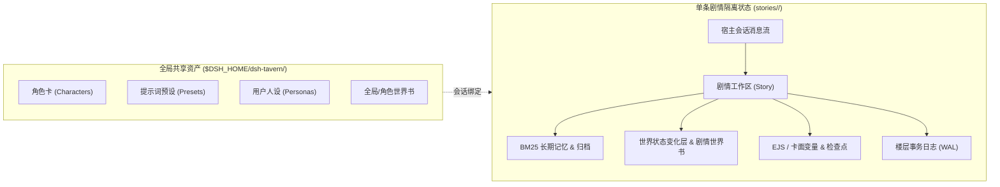

<div align="center">

# dsh-liketavern

**基于 DeepSeek Harness 原生 Agent 运行时的 SillyTavern 角色扮演插件**

[](https://github.com/Amakurai/dsh-liketavern/releases/tag/v0.5.9)
[](https://deepseek-harness.github.io/deepseek-harness/)
[](https://nodejs.org/)
[](./LICENSE)

中文 · [English](./README.en.md) · [更新日志](./CHANGELOG.md)

</div>

`dsh-liketavern` 将 SillyTavern（ST）的角色卡、提示词预设、世界书、正则、EJS 模板与前端交互卡生态引入 [DeepSeek Harness](https://github.com/deepseek-ai/deepseek-harness)（`dsh`）。它不另起独立的发信通道，而是直接运行在 `dsh` 的会话与 Agent 管线之上——由宿主负责模型连接、长上下文历史与工具调度，由插件负责提示词编排、沙箱渲染与事务级剧情状态管理。

## 为什么选择 dsh-liketavern

### 1. 剧情状态与分支真正隔离，重试绝不“串味”
传统角色扮演工具在重新生成或回退历史消息时，长期记忆、世界状态与卡片变量往往停留在最新轮次，导致旧分支带入“未来记忆”。

在 `dsh-liketavern` 中，**角色资产（角色卡 / 预设 / 人设）全局共享，而剧情状态（Story）严格按分支隔离**。每一轮楼层写入均先记录预写式日志（WAL）再落盘正文。无论是重新生成、编辑 AI 回复，还是通过宿主消息栏「在新对话中分支」，系统都会先在独立草稿中回滚未继承楼层的派生记忆、世界状态与变量，再原子发布并绑定子会话——原时间线与新分支互不干扰。

### 2. 不打断叙事的 Agent 长期记忆与动态世界观
插件围绕长线剧情构建了三层上下文机制：
- **三级世界书（Lorebooks）**：支持全局、角色专属与当前剧情私有世界书，兼容常驻条目、递归扫描、次要关键词、反向排除与逻辑与/或触发。
- **世界变化层（World State Delta）**：记录设定在故事推进中的新增、变更与失效，使静态设定随剧情自然演进。
- **BM25 长期记忆**：融合词频相关性与时间衰减权重。日常对话中模型直接流式回复，**仅在缺少设定或需要固化已确定事实时**，才通过宿主原生 PTC（程序化工具调用）按需调用 `tavern_*` 工具读写记忆与设定；超出容量后在会话空闲期自动生成可溯源的归档摘要。

### 3. 开箱即用的 ST 生态兼容：EJS、酒馆助手与原生 MVU
- **角色卡与预设**：支持 V1 / V2 / V3 规范的 PNG 与 JSON 角色卡导入导出、多开场白切换、内嵌世界书与 ST 提示词预设。DeepSeek 官方 API Key 通道支持按冻结的预设布局直接投影消息结构。
- **EJS 模板与持久检查点**：内置兼容 ST 语法的 EJS 提示词模板引擎，支持条件、循环、异步宏、世界书装饰器及 `lodash`、`zod`、`faker`、`jsonrepair` 等工具库，并支持跨步骤的 QuickJS 虚拟机快照恢复。
- **酒馆助手子集与原生 MVU**：支持全局 / 预设 / 角色三级脚本库、剧情变量持久化、同页事件通信与局部消息刷新；内置原生 MVU（Model-View-Update）状态更新执行器，兼容数据流驱动的复杂状态栏角色卡。

### 4. 默认零信任的第三方代码隔离
角色卡附带的正则、模板与 HTML 脚本均视为不受信任输入：
- 提示词组装、世界书评估、正则替换、Markdown 渲染与 EJS 模板统一在可超时终止的 Worker 线程及 QuickJS/WASM 沙箱内执行，不暴露 Node、DOM、网络或模块加载器。
- HTML 交互卡面运行在无同源权限的 `sandbox="allow-scripts"` iframe 中，仅通过受控桥接协议执行枚举业务操作与高度同步，杜绝第三方卡面脚本逃逸至宿主主窗口。

---

## 安装与升级

> **前置要求**：Node.js `>= 24.0.0`、DeepSeek Harness `>=0.2.0-rc.1 <0.4.0-0`、`pnpm`，且已在 `dsh` 中配置好可用的模型。开发基线为 `0.2.1-rc.3`；宿主加载器将范围内的预发布版本纳入判断，较新且尚未验证的宿主应先备份并验证。首次使用请先参阅 [DeepSeek Harness 官方文档](https://deepseek-harness.github.io/deepseek-harness/)。仓库已内置预编译的 `lib/` 产物，安装时无需本地构建。

### 桌面端安装

打开 `dsh` 桌面端 **「插件 → 添加插件」**，填入以下仓库标签地址并安装，完成后重启桌面端：

```text
https://github.com/Amakurai/dsh-liketavern.git#v0.5.9
```

### Web / CLI 在线安装

```bash
# 安装插件到 web profile
dsh plugin --profile web add github:Amakurai/dsh-liketavern#v0.5.9

# 确认安装状态
dsh plugin --profile web list --depth 0

# 启动（或重启）dsh web
dsh web
```

在已验证的 `0.2.0-rc.1` 和 `0.2.2-alpha.2` 中，插件安装时 pnpm 可能提示 profile 内缺少宿主 peer 依赖：这些包由运行中的 dsh 宿主提供，提示本身不代表安装失败。仍需确认宿主版本符合上述范围，并在启动后检查插件是否正常加载；其它 peer 冲突不能一概忽略。

### Release 离线包安装

从 [v0.5.9 Release](https://github.com/Amakurai/dsh-liketavern/releases/tag/v0.5.9) 下载 `dsh-liketavern-0.5.9.tgz`（可配合同页的 `SHA256SUMS.txt` 校验完整性），在下载目录执行：

```bash
dsh plugin --profile web add ./dsh-liketavern-0.5.9.tgz
dsh web
```

### 版本检查与升级

- **检查更新**：在 `dsh` 内进入 **「设置 → Tavern → 关于」**，可查看当前版本并检测 GitHub 最新正式发布与宿主版本兼容性。
- **桌面端升级**：先查阅 [CHANGELOG.md](./CHANGELOG.md) 并备份数据；在桌面端「插件」管理页卸载旧版本，再用新版标签地址重新添加，安装后**完全退出并重启桌面端**（「关于」页仅提供版本查询，不直接执行覆盖安装）。
- **Web / CLI 升级**：使用新版标签重新执行 `dsh plugin --profile web add` 并重启 `dsh web`。升级会自动沿用既有数据目录。

---

## 快速上手

1. **导入角色卡**  
   打开 **「设置 → Tavern → 角色」**，点击「导入角色」选择 PNG 或 JSON 角色卡。导入前会先展示静态兼容性检查报告，若卡片内嵌世界书可一并选择是否导入。
2. **创建 Tavern 会话**  
   新建会话时将模式切换为 **「Tavern 模式」**，在欢迎页点选要扮演的角色卡（新会话不会强制自动绑定默认卡）。
3. **选择开场白并开局**  
   若角色卡带有多条开场白，通过 `‹ ›` 切换心仪的开局场景，点击「开始对话」即可发送第一条消息。
4. **在对话中分支、续写与代答**  
   - **重新生成 / 编辑回复**：在任意 AI 消息操作栏点击重试或编辑，插件会自动切入新分支并回滚后续楼层状态，随时可通过消息下方的 `‹ n/m ›` 在兄弟分支间切换。
   - **继续生成**：顺着当前回复末尾继续扩写。
   - **AI 代答**：让模型以 `{{user}}` 视角草拟下一句台词并自动复制到剪贴板。

---

## 日常使用指南

### 配置入口与作用域



| 我想做什么 | 入口位置 | 生效范围 |
| :--- | :--- | :--- |
| 管理角色卡、预设、世界书、用户人设 | `设置 → Tavern → 角色 / 预设 / 世界书 / 用户` | **全局共享**：修改后对所有绑定该资产的会话在下一轮生效 |
| 设置新建会话时的默认预设与人设 | `设置 → Tavern → 设置 → 默认配置` | **新会话初值**：仅在新会话首次点选角色卡时套用，不影响已有会话 |
| 调整当前对话的预设、人设或作者注释 | `会话顶部角色入口` | **当前会话**：仅对当前剧情的后续轮次生效 |
| 编写当前剧情专属的临时设定 | `会话顶部角色入口 → 编辑本会话世界书` | **当前剧情私有**：随子分支复制与回滚，不污染全局世界书 |
| 查看或手动修订长期记忆 | `会话顶部角色入口 → 记忆` 或 `设置 → Tavern → 记忆` | **所选剧情**：选择具体剧情时立即生效；选「初始状态」仅作用于未来新开剧情 |
| 管理正则规则与交互卡脚本库 | `设置 → Tavern → 正则`<br>`设置 → Tavern → 设置 → 脚本` | 按所选作用域（全局 / 预设 / 角色）生效 |
| 固定插件界面语言（中文 / English） | `设置 → Tavern → 设置 → 界面 → 界面语言` | 默认跟随 `dsh` 宿主语言，手动指定后立即生效 |
| 显示角色消息的头像与名字 | `设置 → Tavern → 设置 → 界面 → 角色头像与名字` | 默认关闭，按宿主原生回复样式只显示正文；打开后在消息上方显示角色头像与卡名，正则与交互卡两种样式下都照常生效 |
| 核对实际发送给模型的请求上下文 | `会话顶部角色入口 → 提示词预览 → 最近请求` | **只读诊断**：「最近请求」展示上一轮真实入模载荷；其余页签为静态 ST 模拟 |

### 提示词投影与采样说明

- **轮次计划冻结**：每轮对话在首次完成提示词组装后会冻结角色、预设、人设、宏时钟、记忆检索结果与采样参数快照，同一轮工具调用后续步骤严格重放该快照；对资产的编辑在下一轮对话生效。
- **通道布局映射**：
  - **DeepSeek 官方 API Key 通道**：由插件持有的适配器装饰器按冻结的预设布局直接投影消息。若目标模型未声明支持历史中途更新 `system`，中途的 `system` 条目会自动合并至首条系统消息并附带兼容诊断说明。
  - **DeepSeek 账号通道与其他模型通道**：沿用宿主 `tavern:standing`（常驻设定）与 `tavern:turn`（当轮上下文与 depth=0 尾注）两段式映射。
- **采样参数透传**：透传 `temperature`、`maxTokens`、`stop` 以及模型公开支持的 `reasoningEffort`（思考档位）；`top_p` 与惩罚项仅作记录与兼容提示，当部署侧锁定关闭思考模式时插件不会强行开启。

---

## 数据存储与备份

所有业务数据均保存在本地 `$DSH_HOME/dsh-tavern/` 下（默认路径为 `~/.dsh/dsh-tavern/`，Windows 为 `%USERPROFILE%\.dsh\dsh-tavern\`），绝不混入源码或 npm 包：

```text
$DSH_HOME/dsh-tavern/
├── characters/         # 角色卡元数据、头像与角色私有资产
│   └── <cardId>/stories/<storyId>/   # 按剧情隔离的状态工作区（记忆、变化层、变量、WAL 日志）
├── library/
│   ├── presets/        # 提示词预设
│   └── lorebooks/      # 全局与角色级世界书
├── personas/           # 用户人设
├── regex/              # 全局正则规则（rules.json）
├── sessions/           # 会话绑定（<sessionId>.json）
└── editor-drafts/      # 编辑器未保存草稿自动暂存（单份上限 2 MiB）
```

### 迁移单个 Tavern 会话

在 **「设置 → Tavern → 设置 → 卡片与数据」** 选择角色和剧情，点击「导出所选会话」。在目标设备的同一位置选择目标工作区和导出的 JSON，再确认导入；完成后会刷新并打开该会话。导出需等待生成结束，包含宿主历史及附件、该剧情的记忆、世界变化、变量、世界书定时器与 WAL，以及所引用的角色和库资产。

这是 Tavern 自有的单会话格式，与宿主 `/export` 的 ZIP 不互通；其它独立分支或子会话不包含在内，完整会话树请使用下方全量备份。导入保留原会话和剧情 ID，不覆盖已存在的同 ID 会话或内容不同的共享资产；如发生冲突请先处理目标数据。全局正则和脚本会影响其它会话，因此目标已有会话时不自动添加这些全局设置。目标宿主的图片策略若会改变附件身份，导入会在发布剧情前拒绝；请调整目标宿主的附件策略后重试。导入中断时，相关会话会被保护为不可用，请用**同一个文件和工作区**重试完成。单份内容上限 128 MiB、JSON 上传上限 192 MiB，超限会明确失败；更大的数据请使用下面的全量备份。文件包含私密对话与原工作区信息，摘要仅用于发现损坏，不能验证来源，请妥善保管并仅导入可信文件。

### 命令行全量备份与恢复（推荐）

插件内置了带 SHA-256 校验清单的离线全量备份工具，可同时备份插件数据、宿主会话与配置：

```bash
# 1. 创建完整备份（请先停止正在运行的 dsh，并通过 --offline 声明无并发写入）
node lib/backup.js create --home "C:/data/dsh-home" --backup "D:/backups/dsh-2026-09-19" --offline

# 2. 校验备份包结构与文件 SHA-256 完整性
node lib/backup.js verify --backup "D:/backups/dsh-2026-09-19"

# 3. 恢复至目标目录
node lib/backup.js restore --backup "D:/backups/dsh-2026-09-19" --target "C:/data/dsh-restored" --offline
```

> 此外，若只需单独存档某条剧情的交互卡变量（上限 1 MiB），可在 **「设置 → Tavern → 设置 → 卡片与数据」** 中直接导出或粘贴 JSON 备份恢复。

---

## 故障排查与诊断

### 一键只读诊断

遇到环境异常时，可运行内置的只读诊断工具检查宿主版本、目录健康度与问题码（**严格脱敏，不输出任何对话正文、本地私有路径或密钥**）：

```bash
dsh plugin --profile web exec dsh-tavern-doctor
# 或输出结构化 JSON：
dsh plugin --profile web exec dsh-tavern-doctor --json
```

### 常见问题

<details>
<summary><b>安装后新建会话看不到「Tavern 模式」或设置页没有 Tavern 入口？</b></summary>

1. 运行 `dsh --version`，确认宿主版本在上述兼容范围内；必要时用 doctor 检查。
2. 运行 `dsh plugin --profile web list --depth 0`，确认插件已安装在 `web` profile 下。
3. 完全重启 `dsh web` 或桌面端，并检查启动终端是否有加载报错。
</details>

<details>
<summary><b>角色卡画面正常显示，但点击按钮、扩展脚本或 MVU 状态栏不更新？</b></summary>

1. 在角色管理或卡片设置中确认已开启 **「允许交互式卡面」**。
2. 进入 **「设置 → Tavern → 设置 → 脚本」**，确认目标脚本及其上级文件夹均已处于启用状态。
3. 若卡片（或全局 / 预设脚本库）包含官方 MVU 入口且未被手动关闭，原生 MVU 会在会话空闲时自动启用；若此前手动关闭过，可在脚本设置页点击 **「开启原生 MVU」**，或在会话顶部角色配置中勾选 **「启用原生 MVU 自动更新」**。MVU 在前端页面内执行，运行期间需保持当前会话页打开。
</details>

<details>
<summary><b>为什么修改了「默认配置」里的预设，或者编辑了「初始状态」记忆，当前对话没有变化？</b></summary>

- 「默认配置」仅在新会话**首次点选角色卡**时写入会话绑定；已有会话请直接通过**会话顶部的角色入口**切换预设或人设。
- 记忆管理页顶部的「初始状态」代表该角色卡的新开局模板，修改后仅对未来新创建的剧情生效；要调整正在进行的对话，请在顶部下拉框中选中对应的具体剧情。
</details>

---

## 深入阅读与架构文档

| 主题 | 说明 | 文档链接 |
| :--- | :--- | :--- |
| **系统架构** | 剧情隔离模型、WAL 事务与恢复协议、提示词投影管线、BM25 记忆检索与归档 | [docs/ARCHITECTURE.md](https://github.com/Amakurai/dsh-liketavern/blob/main/docs/ARCHITECTURE.md) |
| **酒馆助手与桥接** | 卡面沙箱桥接协议、脚本库作用域、变量与世界书 API、原生 MVU 生命周期 | [docs/TAVERN_HELPER.md](https://github.com/Amakurai/dsh-liketavern/blob/main/docs/TAVERN_HELPER.md) · [适配矩阵](https://github.com/Amakurai/dsh-liketavern/blob/main/docs/TAVERN_HELPER_INTEGRATION.md) |
| **EJS 提示词模板** | 模板语法、内置宏与辅助函数、世界书装饰器、QuickJS 检查点机制 | [docs/PROMPT_TEMPLATES.md](https://github.com/Amakurai/dsh-liketavern/blob/main/docs/PROMPT_TEMPLATES.md) · [ST 兼容审计](https://github.com/Amakurai/dsh-liketavern/blob/main/docs/ST_COMPATIBILITY_AUDIT.md) |
| **宿主兼容与安全** | `dsh` 版本升级核对清单、依赖漏洞审计、沙箱边界与发布包白名单规范 | [docs/HOST_COMPATIBILITY.md](https://github.com/Amakurai/dsh-liketavern/blob/main/docs/HOST_COMPATIBILITY.md) · [docs/DEPENDENCY_SECURITY.md](https://github.com/Amakurai/dsh-liketavern/blob/main/docs/DEPENDENCY_SECURITY.md) · [docs/RELEASING.md](https://github.com/Amakurai/dsh-liketavern/blob/main/docs/RELEASING.md) |
| **维护者约定** | 必须保持的九条架构边界、三面契约（host / agent / client）与测试准则 | [AGENTS.md](https://github.com/Amakurai/dsh-liketavern/blob/main/AGENTS.md) |

---

## 本地开发与贡献

项目采用 TypeScript ESM（`NodeNext`）、React 18 与 Vitest，代码按四层划分：
- `src/core/`：纯函数层（提示词组装、世界书触发、正则启发式检查、BM25 检索与格式解析）
- `src/state/`：存储层（角色资产、剧情隔离工作区、记忆索引、模板检查点与 WAL 事务日志）
- `src/node/`：宿主编排层（插件生命周期、typert 服务、预设投影适配器、QuickJS Worker 调度与后台维护）
- `src/client/`：前端界面层（设置面板、会话顶部控制条、消息操作栏、沙箱 iframe 卡面与脚本运行时）

```bash
npm ci                  # 安装锁定依赖
npm run build           # 构建 vendor 运行时、TypeScript 产物与客户端 bundle（lib/ 入库）
npm test                # 运行完整 Vitest 测试套件
npm run package:check   # 校验 npm 发布文件白名单与文档相对链接
```

CI 在 Ubuntu、Windows 上各运行两片完整覆盖的测试，并保留 JSON/JUnit 报告和慢用例摘要。Release 复用同一套检查，直接发布已校验的安装包。分片复现、报告定位与发布恢复见 [CI 与测试说明](https://github.com/Amakurai/dsh-liketavern/blob/main/docs/CI.md)。

<details>
<summary><b>在本地 dsh 环境中挂载源码调试</b></summary>

先运行一次 `dsh web` 初始化 `~/.dsh` 目录，然后将仓库根目录软链接（或 Windows Junction）至 `$DSH_HOME/profiles/node_modules/dsh-liketavern`：

```powershell
# Windows (PowerShell，在仓库根目录执行)
New-Item -ItemType Directory -Force -Path "$env:USERPROFILE\.dsh\profiles\node_modules" | Out-Null
New-Item -ItemType Junction -Path "$env:USERPROFILE\.dsh\profiles\node_modules\dsh-liketavern" -Target (Get-Location).Path
```

```bash
# macOS / Linux (在仓库根目录执行)
mkdir -p ~/.dsh/profiles/node_modules
ln -s "$(pwd)" ~/.dsh/profiles/node_modules/dsh-liketavern
```

挂载后执行 `npm run dev`（即 `dsh web --patch ./cordis.patch.yml`）即可加载本地源码。修改 `src/` 后请运行 `npm run build` 并重启开发实例。
</details>

欢迎通过 [GitHub Issues](https://github.com/Amakurai/dsh-liketavern/issues) 反馈问题（请附上环境版本、复现步骤与脱敏样本，切勿包含 API Key 或私人对话），或在阅读 [AGENTS.md](https://github.com/Amakurai/dsh-liketavern/blob/main/AGENTS.md) 后提交 PR。

## 开源协议

[MIT License](./LICENSE)
